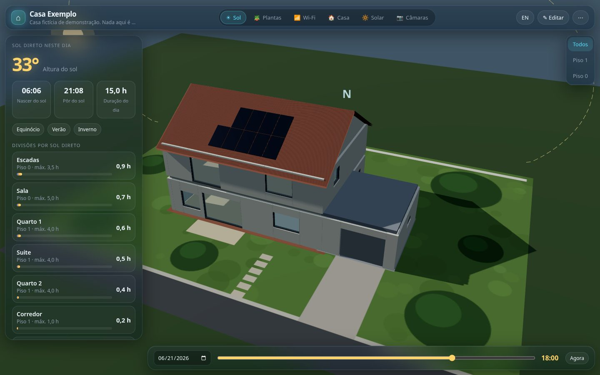
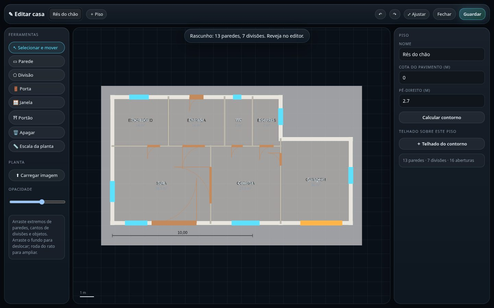

# house twin

A forkable digital twin of your home. Draw (or let AI draft) your floor plans in 2D and get a 3D house you can light with the real sun, place plants and Wi-Fi access points in, and wire to Home Assistant, solar and cameras.

It runs on **your** infrastructure: free on Cloudflare Workers, or in Docker on a Raspberry Pi next to Home Assistant. There is no central server, no account and no telemetry.



**Try the demo:** a fictional house ("Casa Exemplo"). You can run the whole setup wizard and the editor; anything you save stays in your browser.

## What it does

| | |
|---|---|
| **3D from 2D** | Walls, rooms, doors, windows, garage doors and roofs (gable, hip, shed, flat) are generated from a small JSON profile. L-shaped houses get one roof per volume. You can also drop in your own `.glb` model per floor. |
| **Sun** | Sun path for any day, sunrise and sunset, and a heat map of direct-sun hours per room and in the garden, with walls and roofs casting shadows. |
| **Plants** 🪴 | Where each plant lives, when to water, and whether its spot gets the light it needs. Suggests better spots. |
| **Wi-Fi** 📶 | Access points and a predicted signal map through walls and floors; calibrates itself from a few measurements. |
| **Home Assistant** 🏠 | Sensors, lights and switches pinned to rooms, with live state and toggles (lights, switches and fans only). |
| **Solar** 🔆 | Panels on the roof and a clear-sky production estimate per hour, day and month, optionally adjusted with the Open-Meteo cloud forecast. |
| **Cameras** 📷 | View cones in 3D; live snapshot through Home Assistant. |
| **Languages** | English and European Portuguese (`?lang=pt` / `?lang=en`). |



## First-run wizard

1. **Hosting:** claim the house with a one-time setup code and choose a password.
2. **Keys** (all optional): OpenRouter, Home Assistant URL and token. Stored as platform secrets, never in the repo or the profile.
3. **Location:** search or tap the map (OpenStreetMap) to pin the house; time zone.
4. **Floor plans:** upload a PNG or JPG per floor, mark a known distance to set the scale, then either
   - **Draft with AI:** a vision model on OpenRouter traces walls, rooms, doors and windows; you correct the draft in the editor, or
   - **Draw by hand** in the editor over the image, or start from a plain rectangle.
5. **North:** rotate the arrow to match the plan's north.
6. **Aerial view** (optional): upload your own north-up image, or show Esri World Imagery live (never stored). Google imagery is not supported: its terms don't allow storing it.
7. **Roof and terrain.**
8. **Modules:** turn on plants, Wi-Fi, Home Assistant, solar and cameras.
9. **Review and save.**

Everything can be changed later from the **Edit** button (2D editor) or the **⋯** menu (wizard).

## Privacy

- **Your storage only.** The profile, images, password hash and secrets live in your Cloudflare KV namespace or your Docker volume.
- **No telemetry**, no analytics, no third-party scripts. A strict Content-Security-Policy only allows map tiles (OpenStreetMap, Esri), geocoding (Nominatim), OpenRouter and Open-Meteo.
- **Rounded location:** the optional weather forecast (Solar panel, off by default) sends Open-Meteo only rounded coordinates (2 decimals, about 1 km).
- **Images are re-encoded** in the browser before upload, which strips EXIF and GPS tags.
- **Scrubbed export** (⋯ → Export): removes the location, aerial image, plans, SSIDs, survey points, Home Assistant entity IDs and names, so you can share a layout safely.
- **Floor plans go to OpenRouter only** when you press "Draft with AI", using your own key.
- The public demo has no storage at all. If you paste your own OpenRouter key there, it stays in that browser tab (sessionStorage) and goes straight to OpenRouter.

## Deploy on Cloudflare (free plan)

You need a Cloudflare account (free) and Node 20+.

```sh
git clone https://github.com/<you>/house-twin && cd house-twin
npx wrangler@4 login
npx wrangler@4 kv namespace create TWIN        # copy the id into wrangler.jsonc
npx wrangler@4 secret put SETUP_CODE           # any long random string; you type it once in the wizard
npm run cf:deploy
```

Open the `*.workers.dev` URL it prints and follow the wizard. Optional keys:

```sh
npx wrangler@4 secret put OPENROUTER_API_KEY   # AI floor-plan draft
npx wrangler@4 secret put HA_BASE_URL          # e.g. https://ha.example.com (must be reachable from Cloudflare)
npx wrangler@4 secret put HA_TOKEN             # Home Assistant long-lived access token
```

If Home Assistant sits behind Cloudflare Access, also set `CF_ACCESS_CLIENT_ID` and `CF_ACCESS_CLIENT_SECRET` (a service token scoped to that one application).

Notes:
- Storage is Workers KV (free tier: 1 GB, 1,000 writes a day, which is plenty). Images up to 8 MB each.
- Want the house visible without a password (read-only)? Set the var `PUBLIC_VIEW = "1"`.
- Your own read-only demo: `npm run cf:deploy:demo` (uses `wrangler.demo.jsonc`, no storage, no secrets).

## Deploy with Docker (Raspberry Pi or any server)

```sh
git clone https://github.com/<you>/house-twin && cd house-twin
docker compose up -d --build
docker compose logs house-twin | grep "setup code"
```

Open `http://<pi>:8787`, enter the setup code and choose a password. Data lives in `./data` (back it up). The image is `node:22-alpine` with no npm dependencies, and works on arm64 and amd64.

Keys can be saved from the wizard (written to `/data/secrets.env`, mode 600) or set as environment variables in `docker-compose.yml`. On the same machine as Home Assistant, `HA_BASE_URL=http://homeassistant.local:8123` usually works.

Expose it outside your network with Tailscale, a Cloudflare Tunnel or a reverse proxy with HTTPS. Session cookies are marked `Secure` automatically when served over HTTPS.

Without Docker: `npm start` (owner mode) or `npm run demo` (demo), with Node 20+.

## The house profile

A single versioned JSON document (`schema: "house-twin/profile"`, `version: 1`). Units are metres, in a plan frame where x points right and y points down. `location.bearing_deg` is the compass bearing of the plan's +x axis; the wizard sets it from the north arrow.

```jsonc
{
  "schema": "house-twin/profile", "version": 1,
  "name": "My house", "locale": "en",
  "location": { "lat": 0, "lon": 0, "timezone": "Europe/Lisbon", "bearing_deg": 90 },
  "site": { "terrain": { "type": "flat" }, "aerial": null },
  "floors": [{ "id": "f0", "name": "Ground floor", "elevation": 0, "height": 2.7,
    "walls": [{ "id": "w1", "a": [0, 0], "b": [10, 0], "thickness": 0.3 }],
    "rooms": [{ "id": "r1", "name": "Living room", "type": "living", "polygon": [[0,0],[10,0],[10,8],[0,8]] }],
    "openings": [{ "id": "o1", "wall": "w1", "type": "window", "offset": 2, "width": 1.5, "sill": 0.9, "height": 1.2 }] }],
  "roofs": [{ "id": "roof1", "floor": "f0", "type": "gable", "pitch_deg": 30, "overhang": 0.4, "ridge": "x", "outline": [[0,0],[10,0],[10,8],[0,8]] }],
  "modules": { "plants": { "enabled": true, "items": [] } }
}
```

See `web/demo/profile.json` for a complete example and `web/profile/profile.js` for validation. A sample plan image to try the wizard with is in `examples/`.

## Architecture

- `web/`: the app. Plain ES modules, no build step; three.js r170 is vendored in `web/vendor/` (MIT).
  - `engine/`: procedural 3D (`build3d.js`), sun position and irradiance (`sun.js`), sun exposure by ray casting (`exposure.js`), viewer.
  - `modules/`: one file per module (sun, plants, wifi, homeassistant, solar, cameras). Each exports a panel, 3D overlays and editor items.
  - `editor/`: the 2D editor. `wizard/`: the first-run wizard.
- `server/`: one API (`core.js`) shared by the Cloudflare Worker (`worker.js`, KV storage) and the Node server (`node.js`, file storage).
  - Auth: PBKDF2 password hash, HMAC-signed HttpOnly SameSite=Strict session cookie, login rate limit, same-origin check on writes.
  - The Home Assistant proxy only allows `light`, `switch` and `fan` services.

## Development

```sh
npm run demo            # http://localhost:8787 with the demo house
npm test                # unit tests
npm run headers         # regenerate CSP hashes after editing web/index.html
npm run demo:profile    # regenerate the demo house
npm run cf:dev          # local Cloudflare runtime
```

### Keeping personal data out of your fork

`scripts/privacy-guard.mjs` blocks commits that contain API keys or tokens, private keys, private file types, or any string from **your own denylist** (your address, coordinates, Wi-Fi names, email, domain…). The denylist is never committed:

```sh
git config core.hooksPath .githooks
export HT_DENYLIST_FILE=~/.config/house-twin/denylist.txt   # one string per line, outside the repo
```

In GitHub Actions, add the same list as a repository secret named `HT_DENYLIST`. CI also runs gitleaks over the full history.

Your real house profile should not live in a public fork: keep it in your deployment's storage (KV or the Docker volume), or in a separate private repository.

## Limitations

- Roofs are generated per rectangle of the top floor's outline; complex roofs (dormers, valleys between different heights) need a custom `.glb`.
- Terrain is flat or a single slope.
- PDF plans: export the page as an image first.
- The AI draft is a starting point. Expect to fix a few walls and openings in the editor.
- Wi-Fi prediction is a simple path-loss model; calibrate it with a few measurements.

## Em português

O house twin é um gémeo digital da sua casa, para fazer fork e alojar por sua conta: grátis no Cloudflare Workers ou em Docker num Raspberry Pi. A partir das plantas em 2D (desenhadas à mão ou com rascunho por IA) gera a casa em 3D, mostra o sol direto em cada divisão ao longo do dia e junta plantas, Wi-Fi, Home Assistant, painéis solares e câmaras. Os dados ficam no seu armazenamento, sem telemetria. A interface está em português europeu (`?lang=pt`). As instruções de instalação acima aplicam-se tal e qual.

## Licence

MIT. See [LICENSE](LICENSE). Map data © OpenStreetMap contributors; imagery © Esri and its providers when you turn it on.
